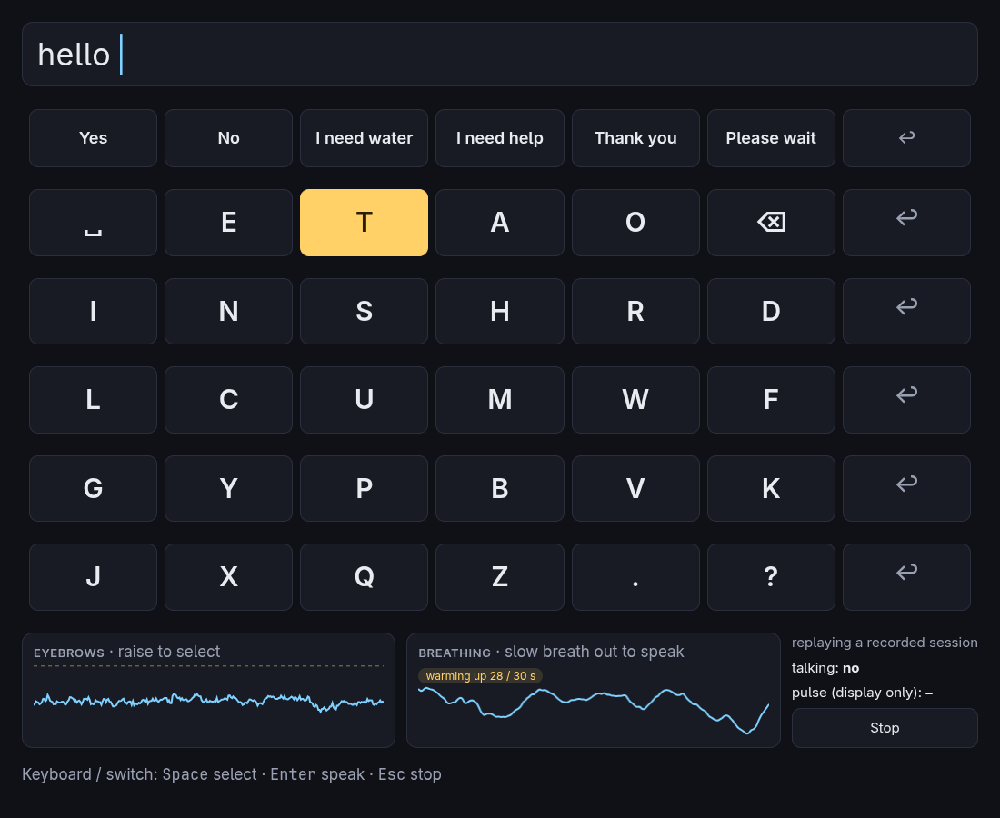
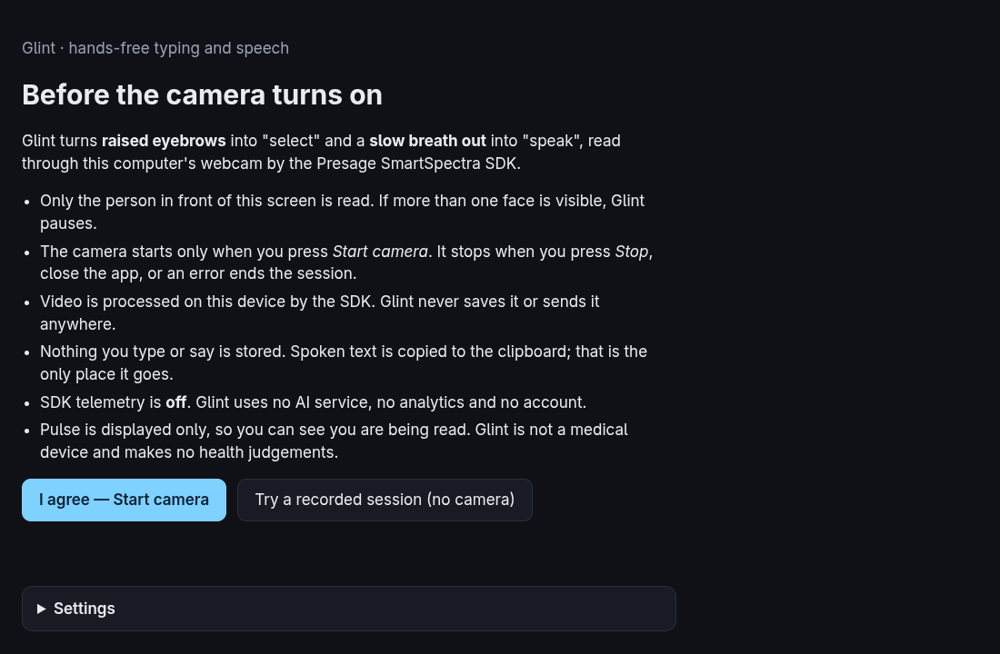
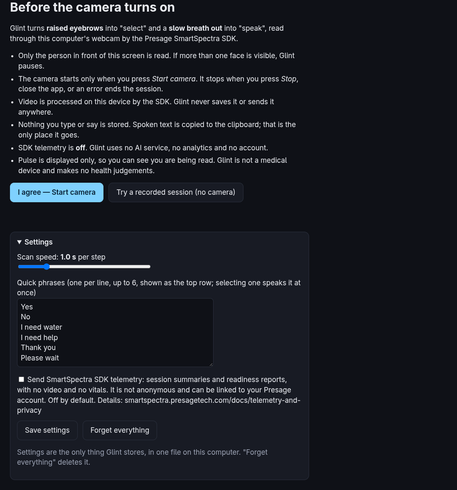

<p align="center">
  
</p>

<h1 align="center">Glint</h1>

<p align="center"><b>Type and speak with your eyebrows and your breath.</b></p>

<p align="center">
  <a href="https://github.com/yashksaini-coder/glint/releases/latest">Download</a> ·
  <a href="#how-you-use-it">How it works</a> ·
  <a href="#privacy-and-consent">Privacy</a> ·
  <a href="#run">Run from source</a>
</p>

A webcam switch-access keyboard for people who can't reliably use their hands or voice, built on the [Presage SmartSpectra](https://smartspectra.presagetech.com/docs/nodejs) Node SDK. No special hardware, no cloud service, no account.



## How you use it

A highlight steps through the board on its own. You need two gestures:

| Gesture | Does | Read from |
|---|---|---|
| **Raise your eyebrows** | Select the highlighted row, then the highlighted key | face landmarks (brow-to-eye distance) |
| **Breathe out slowly** (about 3 s) | Speak the sentence aloud and copy it to the clipboard | chest breathing trace |

- **Back and delete are keys:** `↩` ends every row and `⌫` is on the first letter row.
- **Letters are in frequency order** (space, E, T, A, O first), so the common ones take the fewest steps.
- **Quick phrases** on the top row ("Yes", "I need water", "I need help" …) are spoken as soon as you select them.
- **A keyboard or physical switch works too:** `Space` select · `Enter` speak · `Esc` stop.

## Screens

<table>
<tr>
<td width="50%"></td>
<td width="50%"></td>
</tr>
<tr>
<td><b>Consent first.</b> The camera can only be started from here, after the user has read what is read and what is kept.</td>
<td><b>Settings</b>, for the user or a carer: scan speed, the six quick phrases, SDK telemetry (off by default), and <i>Forget everything</i>.</td>
</tr>
</table>

## How it works


| SDK signal | What Glint does with it |
|---|---|
| `face.landmarks` (478 points) | Brow-to-eye distance ÷ eye spacing → **select** when it rises about 28% and holds |
| `breathing.upperTrace` | Rises on inhale, falls on exhale. A gentle fall of ≥ 6 units for ≥ 2.5 s → **speak** |
| `face.talking` | Blocks speaking while you are talking |
| `validationStatus` + hint | Scanning pauses and shows the SDK's own hint ("Increase light on face", or a hint when more than one face is visible …) |
| `cardio.pulseRate` | Shown in the strip so you can see you're being read. Never used for any decision |

The detectors are small pure functions (`src/renderer/gestures/`), tuned and tested on a real recorded session with timestamped gesture cues ([`recordings/guided.jsonl`](recordings/guided.jsonl): numbers only, no video). Everything the SDK measured is in [`docs/sdk-notes.md`](docs/sdk-notes.md).

**Why eyebrows and not blinks?** The plan was a long blink to select. On the recorded session, five deliberate 1-second eye closures were invisible to both the SDK's blink signal and the face landmarks: the user wears thick-framed glasses and sat in dim light. Eyebrow raises showed up every time (+40%). So the gesture set follows the measurements.

## Privacy and consent

- The camera starts only from the consent screen and is released on Stop, Esc, any error that ends the session, or closing the app.
- Video is processed on the device by the SDK. Glint never writes it to disk or sends it anywhere.
- Nothing you type or say is stored. Spoken text goes to the clipboard and nowhere else.
- The only stored file is `settings.json` in the app's user-data folder. **Forget everything** deletes it.
- SDK telemetry (session summaries and readiness reports; no frames, no vitals, but not anonymous: it can be linked to your Presage account) is **off** unless you turn it on. See [Presage telemetry & privacy](https://smartspectra.presagetech.com/docs/telemetry-and-privacy).
- No LLM Insights, no AI service, no analytics, no accounts.
- **Glint is not a medical device** and makes no health judgements.

## Run

Needs Node ≥ 20 and a free API key from [physiology.presagetech.com](https://physiology.presagetech.com/auth/login).

```bash
npm install
cp .env.example .env   # put your key in PRESAGE_API_KEY
npm start              # GLINT_DEVTOOLS=1 npm start opens DevTools
```

**No key or no camera?** Choose **Try a recorded session** on the first screen. It replays a recorded session through the same detectors, and you can type with `Space` / `Enter`.

**Linux speech:** most distros give Chromium no built-in voice, so Glint falls back to `espeak-ng` (`sudo pacman -S espeak-ng` / `sudo apt install espeak-ng`). Without it, text is still copied.

**Light matters.** Sit facing a lamp or window. A face in shadow is the most common reason tracking fails.

The SDK supports Linux x64 (glibc ≥ 2.35), Windows x64 and macOS arm64.

## Download

Builds are on the [Releases](https://github.com/yashksaini-coder/glint/releases) page (made by [CI](.github/workflows/build.yml)): `Glint-<version>-linux-x86_64.AppImage` and `Glint-<version>-win-x64.exe`. They are unsigned, so Windows SmartScreen will ask you to confirm.

- **Linux:** `chmod +x Glint-*.AppImage && ./Glint-*.AppImage`. If it says *AppImages require FUSE* (Arch, Ubuntu 22.04+), run `APPIMAGE_EXTRACT_AND_RUN=1 ./Glint-*.AppImage` or install `libfuse2`.
- **API key for an installed app:** set `PRESAGE_API_KEY` in your environment, or put `PRESAGE_API_KEY=…` in a `.env` file in the app's user-data folder (`~/.config/Glint/` on Linux, `%APPDATA%\Glint\` on Windows). The key is never bundled into a build.

Build locally with `npm run dist:linux` (or `dist:win` on Windows). Output goes to `out/`.

## Documentation

**[yashksaini-coder.github.io/glint](https://yashksaini-coder.github.io/glint/)**. The source is in [`site/`](site/), built with [Fumadocs](https://fumadocs.dev): `cd site && npm install && npm run dev`. Pages are plain MDX in [`site/content/docs`](site/content/docs), starting with [Scope](site/content/docs/scope.mdx) (what has and hasn't been tested).

## Develop

```bash
npm test                     # detectors on the recorded fixture, scanner, settings validation
npm run smoke                # launches the app, replays, types + speaks via simulated switch presses
node tools/screenshots.ts    # regenerates the app screenshots in docs/img/ (replay mode: no camera, no face)
npm run diagram              # regenerates docs/img/architecture.png from tools/diagram/make.mjs
cd site && npm run og        # regenerates the share images (site/public/og.png, docs/img/social-preview.png)
node tools/sweep.ts          # grid-searches detector thresholds against the recorded cues
```

```
src/main/        Electron main: SDK IPC, camera permission, settings file, clipboard, espeak fallback
src/preload/     bridge (SDK preload + a small window.glint API)
src/renderer/    app.ts (consent → setup → board), gestures/, board/, signals/ (live + replay)
src/shared/      settings schema + sanitizer (used on both sides)
recordings/      guided.jsonl test fixture
tools/           analysis, tuning, smoke test, screenshots
```

## Status

Entry for the DEV × Presage SmartSpectra challenge (Nov 2026). Done: consent flow, scanning board, quick phrases, settings, both detectors, replay mode, Linux/Windows builds. Next: per-user calibration, demo video.

## License

Glint's own code is [MIT](LICENSE). The Presage SmartSpectra SDK (`@smartspectra/node-sdk` and its platform runtimes) is proprietary and under Presage's own terms; packaged builds include its runtime and its bundled third-party notices (`resources/smartspectra/`).
